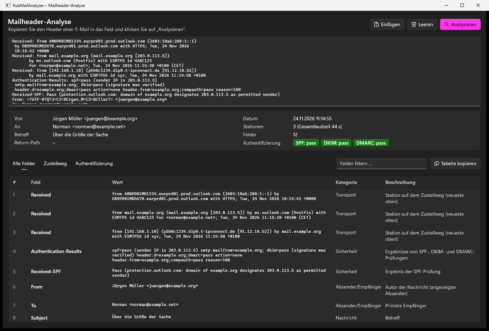

# KubMailAnalyzer

WinUI-3-Anwendung (C#, .NET 10, Windows App SDK 1.8) zur Analyse von E-Mail-Headern.

Header einer E-Mail in das Eingabefeld kopieren, **Analysieren** klicken – die Felder werden tabellarisch ausgewertet:

- **Alle Felder** – Feld, dekodierter Wert (RFC 2047), Kategorie und Beschreibung, mit Filter
- **Zustellweg** – `Received`-Stationen chronologisch mit Zeitpunkt und Verzögerung je Hop
- **Authentifizierung** – SPF, DKIM, DMARC usw. aus `Authentication-Results` und `Received-SPF`

Oben gibt es eine Zusammenfassung (Von, An, Betreff, Datum, Laufzeit, SPF/DKIM/DMARC).
**Tabelle kopieren** legt die aktuelle Tabelle tabulatorgetrennt in die Zwischenablage (z. B. für Excel).
Eine Datei (`.eml`/`.txt`) kann auch als Startargument übergeben werden.



## Bauen und starten

```powershell
dotnet run
```

Die App ist unpaketiert und bringt das Windows App SDK selbst mit (keine Installation nötig).
